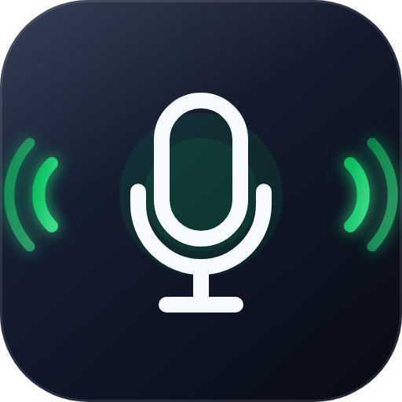
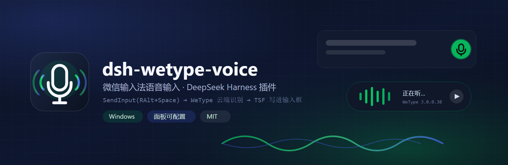
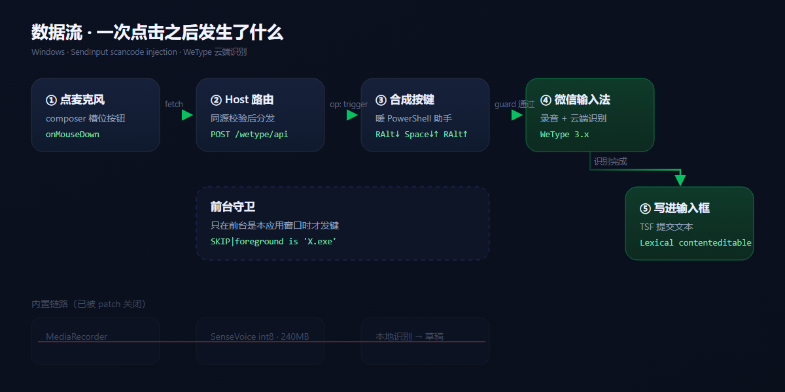

<div align="center">



# dsh-wetype-voice

**把 DeepSeek Harness 输入框上的麦克风，换成微信输入法的语音输入。**

不用内置的那套本地小模型 —— 点一下，微信输入法自己录音、云端识别、直接把文字写进输入框。

[](#换一台电脑)
[](#安装)
[](./package.json)
[](./LICENSE)
[](./package.json)



</div>

---

## 为什么

DSH 内置的语音输入是这条链路：

```
MediaRecorder 录音 → 上传 Host → sherpa-onnx + SenseVoice int8 本地识别 → 插入草稿
```

本地小模型（~240MB int8）短句还行，长句、口音、专有名词掉字严重。

这个插件把整段换成**微信输入法自己的听写能力**：

| | 内置语音输入 | 本插件 |
| --- | --- | --- |
| 识别 | 本地 SenseVoice int8 | 微信输入法云端识别 |
| 中文长句 / 口音 | 一般 | 明显更好 |
| 额外占用 | ~240MB 模型 + 加载时间 | 无 |
| 音频去哪 | 本机 | 微信输入法（DSH 不接触音频） |
| 输入落点 | 注入草稿 | TSF 直接写进输入框 |

## 一次点击之后发生了什么

<div align="center">

</div>

配套实现细节：

| 环节 | 做法 |
| --- | --- |
| 为什么只能合成按键 | 微信输入法没有对外 ASR 接口；设置存在云端 + 加密本地缓存（MMKV / `MM_WETYPE.mmap3` / DPAPI `index.json.enc`），语音触发走**低级键盘钩子 / RawInput**，`RegisterHotKey`、`PostMessage(WM_HOTKEY)` 都不参与 |
| 按键怎么发 | `SendInput` + `KEYEVENTF_SCANCODE`（只发扫描码，不发 VK）；右 Alt 必须用**扩展扫描码 `E0-38`**（`KEYEVENTF_EXTENDEDKEY`），否则会被当成左 Alt |
| 顺序 | `修饰键↓ → 主键↓ → 主键↑ → 修饰键↑`，`SendInput` 返回 `4/4` 才算成功 |
| 为什么是“暖”进程 | 常驻一个 `pwsh` 子进程走 stdio 行协议，暖机后单次往返 **~1ms**（冷启 1.3s） |
| 焦点 | 按钮 `onMouseDown` 里 `preventDefault()`，并对 `[data-lexical-editor="true"]` 兜底 focus —— 微信输入法要往“有焦点的控件”里写字 |
| 前台守卫 | 发键前比对前台窗口进程名，默认只允许宿主自身，避免把语音快捷键打进别的程序 |
| 听写状态 | 微信输入法语音窗 `wetype.flutter.setting` + 标题 `语音输入`，用 `IsWindowVisible` 判断，驱动按钮的“正在听” |

## 安装

### 一键（推荐）

```powershell
git clone https://github.com/shimiei/dsh-wetype-voice.git
cd dsh-wetype-voice
.\install.ps1                 # 自动选择 desktop profile
```

```powershell
.\install.ps1 -Profile all    # 所有带 package.json 的 profile
.\install.ps1 -Uninstall      # 卸载，内置语音输入原样回来
```

脚本会：备份 `package.json`（`*.bak-wetype-<时间戳>`）→ 拷插件到 `plugins\` 与 `node_modules\` → 注册 `dependencies` 与 `dsh.profile.bundles` → 自检注册结果。

### 手动

1. 本目录拷到 `~/.dsh/profiles/<profile>/plugins/dsh-wetype-voice`，再拷一份到 `~/.dsh/profiles/<profile>/node_modules/dsh-wetype-voice`；
2. `~/.dsh/profiles/<profile>/package.json`：

```jsonc
{
  "dependencies": { "dsh-wetype-voice": "file:./plugins/dsh-wetype-voice" },
  "dsh": { "profile": { "bundles": [/* … */ "dsh-wetype-voice"] } }
}
```

3. **重启 DeepSeek Harness**（插件在启动时加载，浏览器半侧不热重载）。

## 配置

### 插件面板

> **侧栏 → 插件 → 已安装 → dsh-wetype-voice → 该行的「配置」**

| 字段 | 说明 |
| --- | --- |
| **语音快捷键** | 要和微信输入法「启动语音输入」完全一致。点 **录入** 直接按组合键抓取（靠 `event.location` 分辨左右修饰键），或点 **自动探测快捷键** 让插件自己试 |
| **注入方式** | `scan`（默认，扫描码）/ `vk`（虚拟键码）/ `both` |
| **前台守卫** | `auto`（只在本应用前台时发键）/ `list`（只允许列出的进程）/ `any` |
| **允许的进程** | `guard = list` 时生效，逗号分隔，如 `chrome.exe, msedge.exe` |
| **预热延时** | 发键前等多久，默认 `60ms` |
| **试一次** | 立刻按一次当前快捷键，验证绑定对不对 |
| **恢复默认** | 回到 `ralt+space` / `scan` / `auto` / `60` |

保存后**立即生效**（写在 `$DSH_HOME/wetype-voice.json`，每次请求现读），不用重启。

### 配置文件

```jsonc
// $DSH_HOME/wetype-voice.json
{
  "hotkey": "ralt+space",
  "injectMode": "scan",
  "guard": "auto",
  "allowProcesses": [],
  "leadMs": 60
}
```

### HTTP 接口

页面内部用 `POST /wetype/api`（仅回环地址或同源请求，其余 403）：

| op | 作用 |
| --- | --- |
| `status` | 当前配置、微信输入法版本、上一次触发结果、触发次数 |
| `trigger` / `start` / `stop` | 按一次快捷键（微信输入法里它是开关式） |
| `state` | 语音窗是否可见 → `listening` |
| `detect` | 逐个试候选快捷键；`persist: true` 把命中的写进配置 |
| `save` | 批量保存 `hotkey` / `injectMode` / `guard` / `allowProcesses` / `leadMs`（先全量校验再落盘） |
| `setHotkey` / `setGuard` | 单项快捷设置 |
| `probe` | 探测微信输入法安装位置与版本 |
| `ping` | 注入器往返，返回 `READY\|1` |

```powershell
Invoke-RestMethod -Method Post -Uri http://127.0.0.1:<port>/wetype/api `
  -ContentType 'application/json' -Body '{"op":"status"}'
```

### 快捷键格式

```
修饰键+修饰键+…+主键
```

- 修饰键：`ctrl / lctrl / rctrl`、`alt / lalt / ralt`、`shift / lshift / rshift`、`win / lwin / rwin`
- 主键：`a-z`、`0-9`、`space`、`enter`、`esc`、`tab`、`backspace`、`f1-f12`、`` ` `` `-` `=` `[` `]` `\` `;` `'` `,` `.` `/`、`left/right/up/down`、`insert/delete/home/end`

## 换一台电脑

没有硬编码路径：profile 从 `$DSH_HOME` 推、脚本从 `import.meta.url` 推、守卫比对的目标进程名从 `process.execPath` 推。满足三条即可：

1. **Windows**（`SendInput` / P/Invoke）；
2. 装了微信输入法（探测 `%ProgramFiles%`、`%ProgramFiles(x86)%`、`%ProgramW6432%`、`%LOCALAPPDATA%`）；
3. `hotkey` 与该机器微信输入法的绑定一致 —— **唯一需要确认的一项**，用「录入」或「自动探测」解决。

`detect` 的候选顺序：

```
ralt+space → rctrl+space → lalt+space → ctrl+space → ctrl+alt+space
→ rctrl+ralt+space → lctrl+space → shift+space → lalt+shift → ralt+shift
```

> 探测前请把语音窗关掉、让 DSH 保持前台；遇到守卫拒绝会立即停止，不会在别的程序里乱按键。

兼容性：注入器优先 `pwsh`，没有就退到 Windows PowerShell 5.1；`install.ps1` 与 `injector.ps1` 存成 **UTF-8 with BOM**，否则 5.1 会把中文（语音窗标题匹配要用）读成乱码。

## 故障排查

`status.lastResult` 的三种典型值：

| 值 | 含义 | 处理 |
| --- | --- | --- |
| `OK\|ralt+space` | 键已发出 | 微信输入法没反应，多半是 `hotkey` 与它的绑定不一致 |
| `SKIP\|foreground is 'X.exe', expected 'DeepSeek Harness.exe'` | 前台守卫拦下 | 先把 DSH 切到前台；或改 `guard: list` 并把该进程加进白名单 |
| `ERR\|…` | 注入器或键名问题 | `unknown key 'x'` = 键表不支持；`SendInput sent 0/4` = 会话/权限异常 |

其他常见情况：

- **点了没反应**：`{"op":"status"}` 看 `weType.installed` 与 `lastResult`；
- **说了话不出字**：确认 DSH 输入框有焦点（本插件只负责唤出语音条，文字由微信输入法写）；
- **听写自己结束**：微信输入法静音约 1–3 秒自动收尾，这是它的行为，再点一次即可。

## 项目结构

```
cordis.patch.yml   关掉内置语音输入四项 + 插入本插件
lib/index.js       Host：POST /wetype/api，op 分发，配置读写与校验
lib/injector.js    常驻 PowerShell 子进程句柄（自动重启、行协议）
lib/injector.ps1   P/Invoke：SendInput / 扫描码表 / 前台守卫 / 语音窗探测
client.js          浏览器侧：输入框麦克风按钮 + 插件面板配置页
install.ps1        一键安装 / 卸载
assets/            banner、图标、架构图（SVG 源 + PNG）
```

## 已知限制

- 只在 Windows 上工作；
- 依赖微信输入法的云端识别，离线不可用；
- `detect` 是**试**出来的，不在候选表里的绑定需要手动录入；
- 内置语音输入的四项已被 patch 禁用，要回去就删掉 `cordis.patch.yml` 里那些 `disabled: true`。

## License

[MIT](./LICENSE)

<div align="center"><sub>不是微信/腾讯官方项目，与 DeepSeek 也无隶属关系；只是把两个东西接起来。</sub></div>
